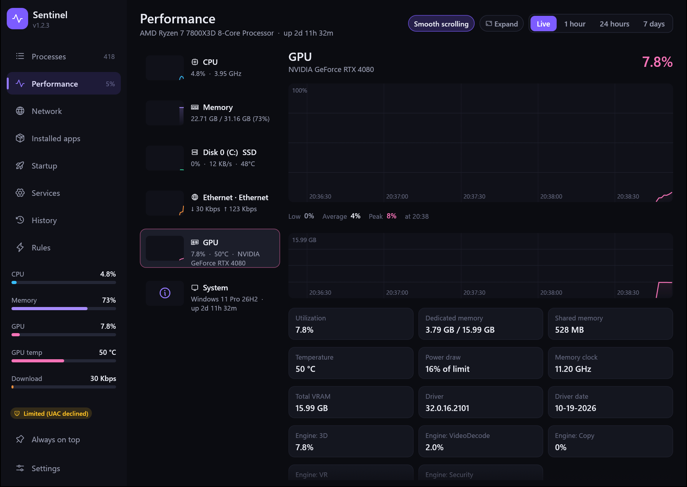
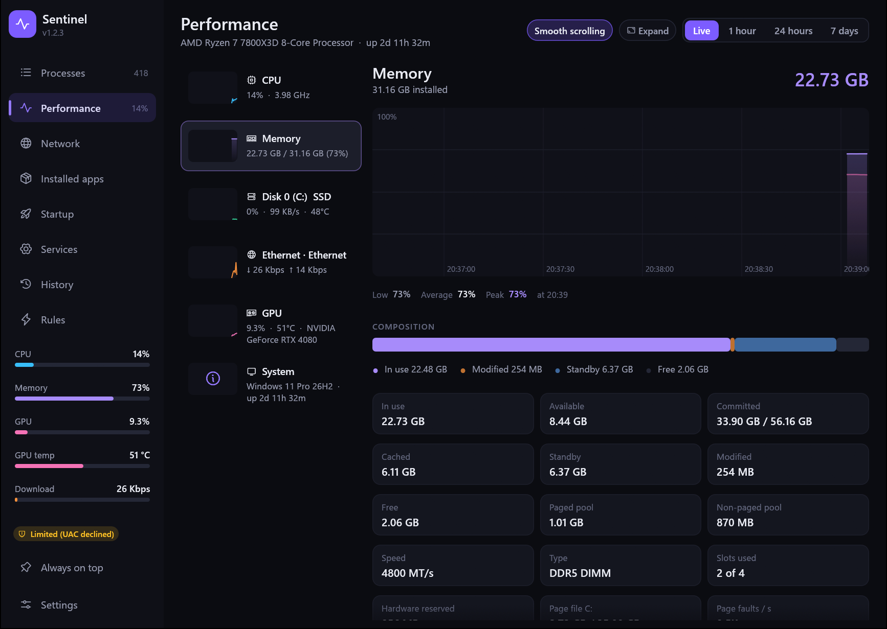
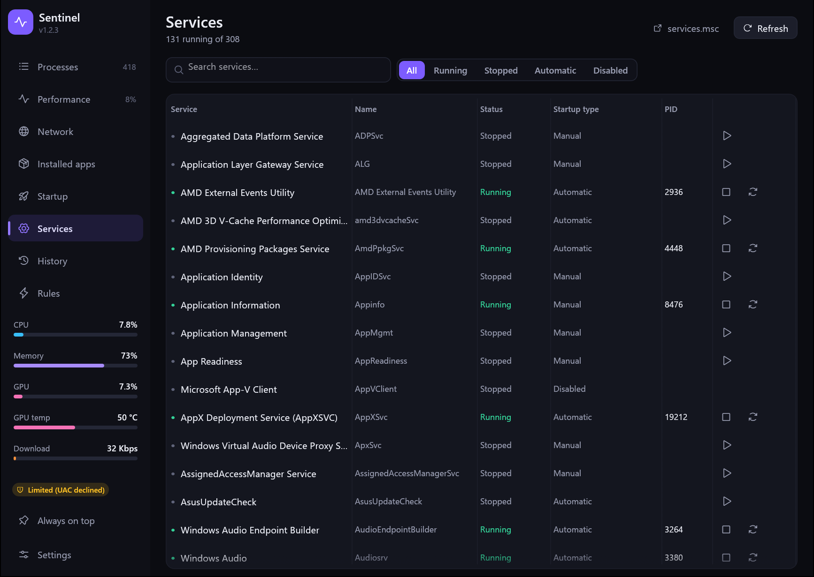

# Sentinel

A fast, modern replacement for Windows Task Manager, written in Rust (egui).

It runs hidden in the background with admin rights and opens instantly on **Ctrl+Shift+Esc**, with no tray icon.



| | |
|---|---|
|  |  |
| **Performance** shows CPU, memory, disks, network and GPU with live, 1-hour, 24-hour and 7-day history. | **Services** lists every Windows service with its status and startup type, and starts, stops or restarts it in one click. |

These were taken from a test copy started without admin rights, so the sidebar shows "Limited".

## Features

- **Processes**: grouped apps, background and Windows processes, a tree or flat list, and a details panel. Rows stay in a steady order. Includes end task/tree, suspend, priority, CPU affinity, restart, block internet access, find what's locking a file, and type-to-search.
- **Performance**:
  - CPU: live clock, cores, caches, context switches, interrupts, DPC time.
  - Memory: standby, modified, free, page file, compressed, and RAM modules from SMBIOS.
  - Disks: IOPS, latency, queue length, temperature, and volumes.
  - Network: packets, errors, TCP retransmits.
  - GPU: temperature, fan, power, memory clock, and driver.
  - System: Windows build, motherboard, BIOS, and boot time.
- **Network**: per-app upload and download (ETW), live connections with reverse DNS, adapters, latency/jitter/loss monitoring, and per-app firewall blocking.
- **Installed apps**: uninstall, remove broken entries whose files are already gone (with a registry backup), and clean up leftovers.
- **Startup apps and Services**: enable, disable, sort, and search.
- **History and Rules**: per-process history, an activity log, and automatic actions (priority, affinity, block, kill over a limit).
- Always on top, hide when clicking away, and self-updates from GitHub Releases.

## Install

```powershell
.\install.ps1
```

This builds a release, copies it to `%ProgramFiles%\Sentinel` (one UAC prompt), and adds a Start menu shortcut.

The first start asks for admin once. Sentinel then registers a scheduled task so later starts are elevated with no prompt, including at sign-in. In **Settings**, turn on **Replace Windows Task Manager** to make every Task Manager entry point open Sentinel.

## Release a new version

```powershell
.\release.ps1 1.1.0 "What changed"
```

This bumps `Cargo.toml`, builds, runs the tests, then commits, tags, and pushes. GitHub Actions builds `Sentinel.exe` and its `.sha256` file and publishes the release. Installed copies pick it up within a few hours and update silently while hidden.

## Development

- `cargo run` starts a dev build. Dev builds never register autostart, the scheduled task, or the Task Manager replacement.
- Set `SENTINEL_TEST=1` for a separate data folder and a window titled "Sentinel (TEST COPY)".
- `sentinel --hw-dump` prints the hardware and kernel metrics to the console.
